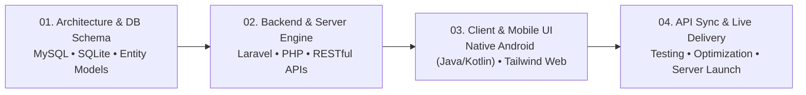
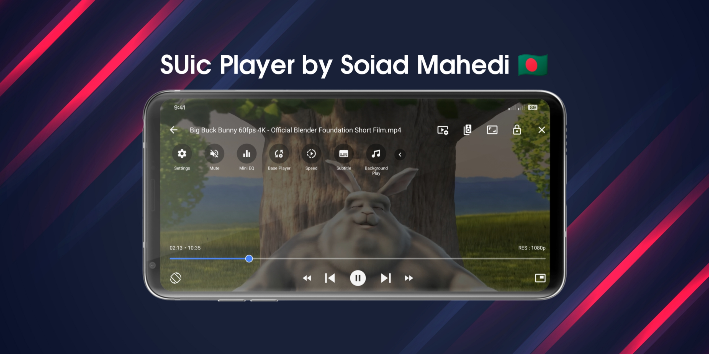
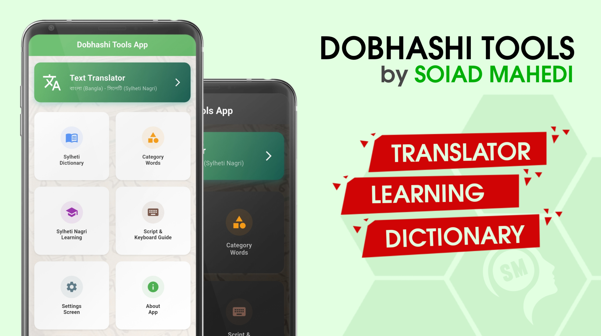
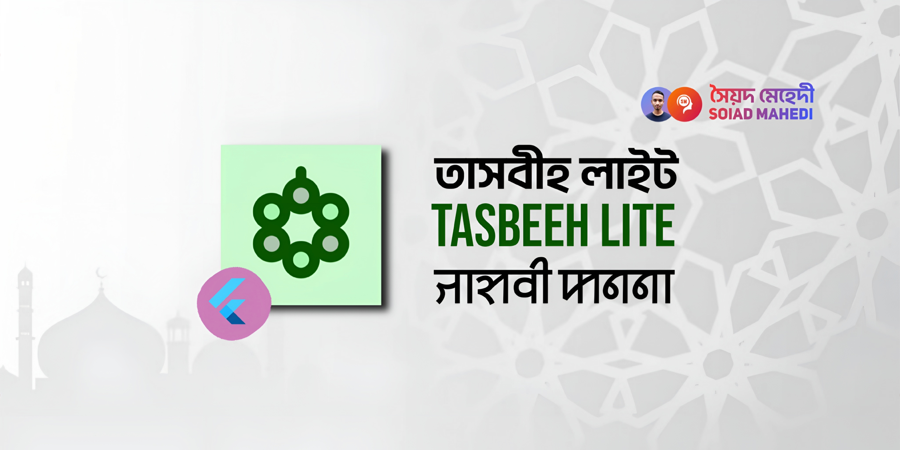

  

  # Assalamu Alaikum, I'm Soiad Mahedi 👋
  ### `< Native Android Developer & Full-Stack Web Developer />`

  

    <b>Peace be upon you</b> • Architecting robust Native Android applications, scalable Laravel backends & sharing developer knowledge.
  

  

    
    
    
    
  

   

  

---

## 👨‍💻 About Me

- 📍 Based in **Natore, Rajshahi, Bangladesh** 🇧🇩
- 📱 **Android Native Specialist**: Building high-performance, battery-efficient Android apps with **Java**, **Kotlin**, Android Jetpack, Media3, and clean architecture.
- 🌐 **Full-Stack Web Architect**: Crafting performant server backends in **PHP** & **Laravel**, relational database schemas with **MySQL** / **SQLite**, and responsive modern frontends with **Tailwind CSS** and **JavaScript**.
- 🎬 **Tech Content Creator**: Creating educational tech walkthroughs, Android tutorials, and knowledge-based videos on YouTube across 3 dedicated channels.
- ⚡ **Core Philosophy**: Clean code, zero fluff, robust security, and seamless developer-to-production workflows.

---

## 🛠️ Tech Stack & Tooling

### Mobile & Native

### Web & Backend

### Cloud, BaaS & DevOps

---

## 🔄 Working Flow (How I Build Software)

| Step | Milestone | Key Focus |
| :---: | :--- | :--- |
| **01** | **System & DB Architecture** | Planning database normalization, table relations, constraints, and REST API contract specifications. |
| **02** | **Backend & Server Engine** | Implementing secure authentication, controllers, validation rules, and scalable REST APIs with Laravel & PHP. |
| **03** | **Mobile & Web Interfaces** | Crafting native Android apps (Java/Kotlin) and responsive, mobile-first web frontends with Tailwind CSS. |
| **04** | **Testing & Live Delivery** | End-to-end API integration, security auditing, speed optimization, and deployment to live production servers. |

---

## 🚀 Featured Projects

<table>
  <tr>
    <td width="50%" align="center">
      
       
      <b>SUic Player</b>
    </td>
    <td width="50%" align="center">
      
       
      <b>Bengali Muslim</b>
    </td>
  </tr>
  <tr>
    <td valign="top">
      <code>Java Native</code> • <code>Media3</code>  
      High-performance Android media player with hardware acceleration, ExoPlayer engine, and smooth gesture controls.
        
      🔗 <a href="https://soiadmahedi.top/suicplayer/">View Details</a> &nbsp;|&nbsp; 📥 <a href="https://github.com/soiadmahedi/SUic-Player/releases/download/2.0/suicplayer-v2.0-universal-release.apk">Download APK</a>
    </td>
    <td valign="top">
      <code>Flutter</code> • <code>Website</code>  
      Islamic web platform providing Quran, authentic Hadith collections, and Islamic literature with an accessible UI.
        
      🌐 <a href="https://bengalimuslim.top/">Visit Website</a>
    </td>
  </tr>
  <tr>
    <td width="50%" align="center">
      
       
      <b>Dobhashi Tools</b>
    </td>
    <td width="50%" align="center">
      
       
      <b>Tasbeeh Lite</b>
    </td>
  </tr>
  <tr>
    <td valign="top">
      <code>Flutter</code> • <code>Multi OS</code>  
      Offline educational application built to learn, translate, and preserve the historical Sylheti Nagri script.
        
      🔗 <a href="https://soiadmahedi.top/dobhashitools/">View Details</a>
    </td>
    <td valign="top">
      <code>Flutter</code> • <code>Open Source</code>  
      Minimalist digital Dhikr counter app engineered for battery efficiency, privacy, and distraction-free daily use.
        
      🐙 <a href="https://github.com/soiadmahedi/tasbeehlite">Source Code</a>
    </td>
  </tr>
</table>

---

## 🎬 Content Creation & YouTube

<table>
  <tr>
    <td width="33%" align="center">
      <b>Soiad Mahedi</b> 
      Education & Facts  
      
Interesting facts, history, science, and knowledge-based videos in Bangla.

      
    </td>
    <td width="33%" align="center">
      <b>Soiad Mahedi Tech</b> 
      Coding & Tutorials  
      
Android (Java/Kotlin), Flutter, PHP, Laravel, and programming troubleshooting.

      
    </td>
    <td width="33%" align="center">
      <b>Bahauddin Mahedi</b> 
      Entertainment  
      
Engaging reels, funny shorts, and entertainment content designed to bring a smile.

      
    </td>
  </tr>
</table>

---

## 📊 GitHub Statistics

  
  

---

## 📬 Let's Connect

- 🌐 **Official Website**: [soiadmahedi.top](https://soiadmahedi.top)
- 📧 **Email**: [contactsoiadmahedi@gmail.com](mailto:contactsoiadmahedi@gmail.com)
- 💬 **Messenger**: [m.me/soiadmahediofficial](https://m.me/soiadmahediofficial)
- 💼 **Fiverr**: [fiverr.com/soiadmahedi](https://www.fiverr.com/soiadmahedi)
- 📘 **Facebook**: [facebook.com/soiadmahediofficial](https://www.facebook.com/soiadmahediofficial)
- 🔗 **LinkedIn**: [linkedin.com/in/soiadmahedi](https://www.linkedin.com/in/soiadmahedi)
- 📱 **TikTok**: [tiktok.com/@soiadmahediofficial](https://www.tiktok.com/@soiadmahediofficial)
- 🐙 **GitHub**: [@soiadmahedi](https://github.com/soiadmahedi)
